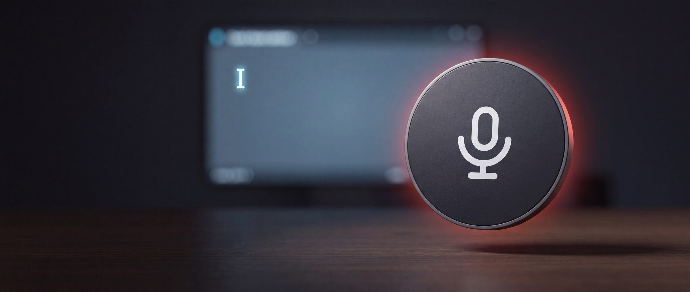

<p align="center">
  
</p>

# Abla

Voice dictation for Linux. A floating button: click, talk, click again, and the text lands wherever your cursor is. Any window, any app, browsers included.

- **Never steals focus.** The button lives on a Wayland layer-shell surface that stays above everything and never takes the keyboard, so the caret stays exactly where you were typing.
- **Your provider, your key.** Transcription runs on Mistral, OpenAI, Groq or any OpenAI-compatible endpoint, with a key you paste once. Nothing goes through anyone else's server.
- **Live or batch.** Pick a live model and watch the words appear beside the button while you speak; pick a batch model and get punctuated text a couple of seconds after you stop.
- **No traces.** Audio lives in memory and is discarded after each dictation. Nothing is logged, nothing is sent anywhere but your provider, and the clipboard is put back the way it was.
- **One small binary.** Rust and GTK 4, starts instantly, drawn pixel by pixel at any size.

## Requirements

- A Wayland compositor that speaks layer-shell: **KDE Plasma 6**, **sway**, **Hyprland**, **niri**, **wayfire**, **labwc**, **river**. GNOME does not support layer-shell, so Abla does not run there yet.
- PipeWire for the microphone (`pw-record`), which every current distribution ships.
- GTK 4.12 or newer and `gtk4-layer-shell`.
- `ydotool` for automatic pasting. Optional: without it Abla leaves the text on the clipboard for you to paste. See [Automatic pasting](#automatic-pasting).
- An API key from [Mistral](https://console.mistral.ai/api-keys), [OpenAI](https://platform.openai.com/api-keys) or [Groq](https://console.groq.com/keys). Abla does not quote prices; what a key costs is between you and your provider.

## Install

```sh
curl -fsSL https://raw.githubusercontent.com/levongabrielyan/abla/main/install.sh | sh
```

That downloads the latest release into `~/.local/bin`, adds **Abla** to your application menu and tells you if a runtime library is missing. The libraries, per distribution:

```sh
# Fedora
sudo dnf install gtk4 gtk4-layer-shell pipewire-utils ydotool
# Debian, Ubuntu
sudo apt install libgtk-4-1 libgtk4-layer-shell0 pipewire-bin ydotool
# Arch
sudo pacman -S gtk4 gtk4-layer-shell pipewire ydotool
```

To build from source instead, install the development packages (`gtk4-devel gtk4-layer-shell-devel` on Fedora, `libgtk-4-dev libgtk4-layer-shell-dev` on Debian and Ubuntu, `gtk4 gtk4-layer-shell` on Arch) and run:

```sh
cargo install --git https://github.com/levongabrielyan/abla
abla desktop
```

## First run

Start **Abla** from the application menu, or run `abla`. The first time, a settings window asks for:

1. **Provider.** Mistral, OpenAI, Groq, or a custom OpenAI-compatible base URL.
2. **API key.** Abla checks it with the provider straight away and lists the transcription models that key can use. Nothing is typed in by hand, so the list is always today's.
3. **Model.** Models marked **live** stream text while you speak. The others answer once you stop, usually with better punctuation.
4. **Language.** Detect automatically, or pin one.
5. **Start at login.**

Each provider remembers its own key and model, so switching between them later costs nothing. The key is stored in `~/.config/abla/config.toml`, readable only by you.

## Using it

- **Click** the button to start. It turns the recording colour and shows the seconds. **Click again** to stop; the text is pasted where your cursor is.
- **Drag** the button anywhere. It stays where you drop it.
- **Right-click** for size, recording colour, settings and quit.
- **Keyboard.** Bind `abla toggle` to any key in your desktop and forget the mouse:

  | Desktop | Where |
  |---|---|
  | KDE Plasma | System Settings → Keyboard → Shortcuts → Add New → Command or Script: `abla toggle` |
  | sway | `bindsym $mod+d exec abla toggle` |
  | Hyprland | `bind = SUPER, D, exec, abla toggle` |
  | niri | `Mod+D { spawn "abla" "toggle"; }` |

## Automatic pasting

Wayland has no portable way for one application to type into another. Abla uses `ydotool`, whose daemon owns `/dev/uinput` and presses Ctrl+V on Abla's behalf. Most distributions start `ydotoold` as root with a socket only root can reach, so give the socket to your user once:

```sh
sudo systemctl enable --now ydotool
sudo mkdir -p /etc/systemd/system/ydotool.service.d
printf '[Service]\nExecStart=\nExecStart=/usr/bin/ydotoold --socket-path=/run/user/%s/.ydotool_socket --socket-own=%s:%s --socket-perm=0600 --mouse-off\n' \
  "$(id -u)" "$(id -u)" "$(id -g)" | sudo tee /etc/systemd/system/ydotool.service.d/override.conf
sudo systemctl daemon-reload && sudo systemctl restart ydotool
```

`abla doctor` tells you whether it worked. Without ydotool, Abla copies the text to the clipboard and shows a notification; you press Ctrl+V yourself.

Abla pastes by putting the text on the clipboard, pressing Ctrl+V, and restoring whatever the clipboard held before. If the previous content was not text, it is not restored.

## Commands

```
abla                    the floating button (opens settings on first run)
abla setup              settings window
abla toggle             start or stop dictation in the running Abla
abla doctor             check session, microphone, pasting, config and provider
abla desktop            add Abla to the application menu
abla autostart on|off   start Abla at login
abla transcribe f.wav   transcribe a 16 kHz mono WAV with the configured provider (add --live for a live model)
```

## Configuration

`~/.config/abla/config.toml`, written by the settings window. You can edit it by hand while Abla is not running.

```toml
[provider]
name = "mistral"                       # mistral | openai | groq | custom
base_url = "https://api.mistral.ai/v1"
api_key = "…"
model = "voxtral-mini-latest"
realtime = false                       # true for a live model
language = ""                          # ISO 639-1, or empty to detect

[button]
size = 64                              # 52, 64, 72 or 88
color = "#d93a3f"
margin_right = 40                      # distance from the screen edges
margin_bottom = 60

[general]
autostart = false
```

Setting `ABLA_API_KEY` in the environment overrides the stored key without writing it anywhere.

## Privacy

Audio is captured to memory, sent to the provider you chose, and dropped. Abla keeps no recordings, no transcripts and no logs of what you said. It makes no network connection except to that provider, and has no analytics of any kind. The configuration file, which holds your key, is created with permissions `0600` inside a `0700` directory.

## Building

```sh
cargo build --release      # binary in target/release/abla
cargo test
```

Abla is written in Rust with [gtk4-rs](https://gtk-rs.org/) and [gtk4-layer-shell](https://github.com/wmww/gtk4-layer-shell). Everything on the button is drawn with cairo; there are no images or CSS themes to break.

## License

[MIT](LICENSE)
